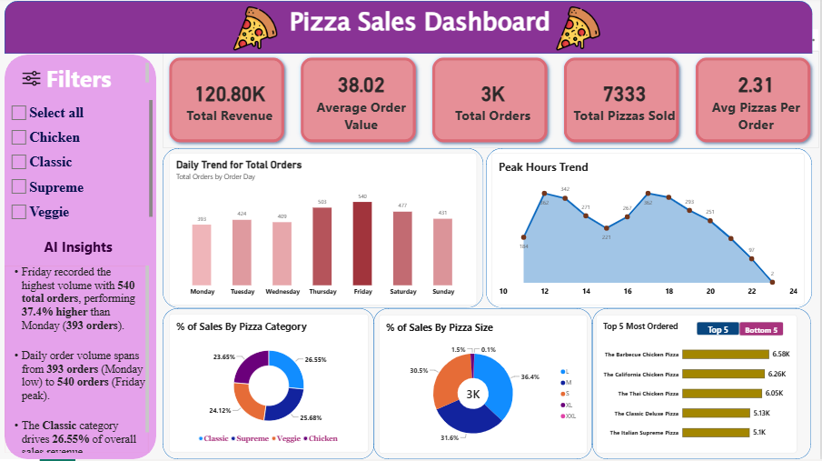
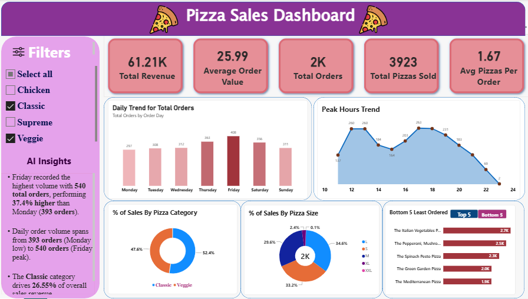

# Pizza Sales Analytics
Prepared by Devansh Joshi, Data Analyst.

## Project Overview
This repository contains an end-to-end data analytics project that explores pizza sales data to uncover business trends, optimize operations, and improve revenue strategies. The analysis is based on a transactional dataset containing approximately 7,300 rows of sales records. The project transitions from raw data processing to deep SQL analysis, culminating in an interactive Power BI dashboard.

## Tech Stack & Workflow
* **Data Cleaning:** Microsoft Excel was used to perform initial data cleaning and formatting on the raw dataset.
* **Data Analysis:** MySQL was utilized to query the `pizza_db.pizza_sales` database, calculate key metrics, and extract actionable business insights.
* **Data Visualization:** Power BI was used to build an interactive dashboard incorporating DAX formulas, custom measures, and AI-driven narrative insights.

## Dashboard Previews

### Overall Performance Dashboard

### Filtered View (Classic & Veggie Categories)

## Key Business Insights
The analytical SQL queries and Power BI visualizations revealed several critical performance metrics and trends:
* **Revenue & Ordering Baseline:** The business generated $120,804.65 in total revenue from 7,333 total pizzas sold[cite: 3]. The average order value (AOV) stands at $38.02, with customers buying an average of 2.31 pizzas per order[cite: 1, 3].
* **Daily and Monthly Trends:** Friday experiences the highest order volume with 540 total orders, which is 37.4% higher than the Monday low of 393 orders[cite: 1]. Additionally, January is the peak month for overall demand[cite: 3].
* **Peak Operating Hours:** Daily footfall consistently peaks during the lunch rush around 12:00 PM and the dinner hours between 5:00 PM and 7:00 PM[cite: 1].
* **Category and Size Preferences:** The "Classic" pizza category is the primary revenue driver, accounting for 26.55% of overall sales[cite: 1, 3]. Large-sized pizzas dominate the size mix, generating 46.11% of the total revenue[cite: 3].
* **Product Performance:** The Barbecue Chicken Pizza generated the highest overall revenue at $6,577.50, while the Pepperoni Pizza had the highest unit volume with 396 orders[cite: 3]. Conversely, The Brie Carre Pizza was the lowest-performing item in both revenue and quantity[cite: 3].

## Dashboard Features
* **AI Insights:** The dashboard utilizes Power BI's AI capabilities to automatically generate textual summaries of daily trends and category contributions directly alongside the charts[cite: 1].
* **Dynamic Filtering:** Users can interactively filter the entire dashboard by specific pizza categories, such as isolating total revenue and peak hour trends for just the "Classic" and "Veggie" options[cite: 2].
* **Custom DAX Measures:** The underlying data model relies on robust DAX calculations to accurately serve KPIs like total orders, average order value, and percentage breakdowns across the visualizations.
